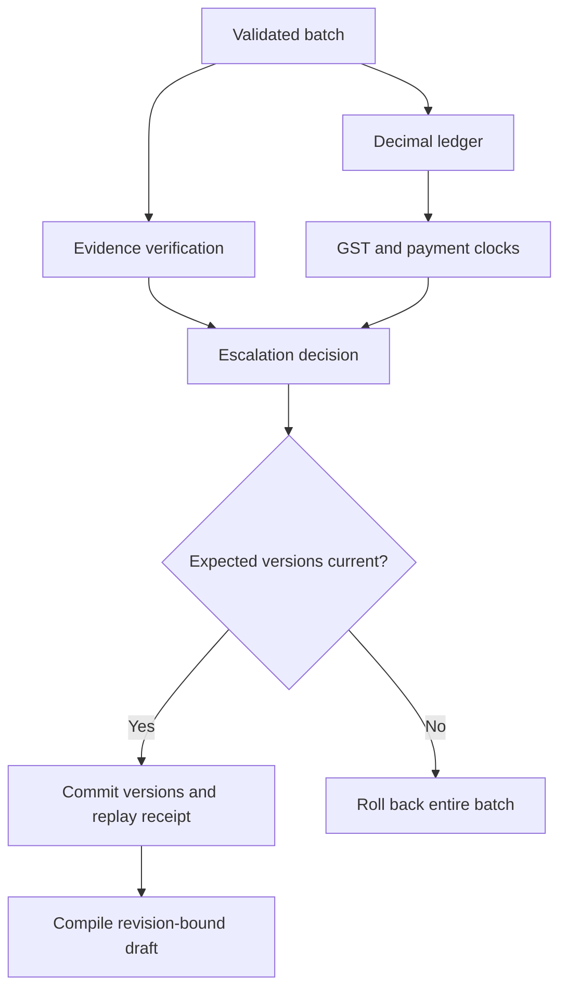

# ProofPay decision service

The FastAPI service accepts receivables from an ERP or reviewed import, evaluates the invoice, and journals both its complete source and the decision returned by policy version 2.0. It exposes versioned inputs for downstream correspondence and audit. The local React workbench and CLI use the same analysis functions. Their editable demo database and the API decision journal have separate lifecycles; importing into one does not implicitly publish records to the other.

## Start the service

From the repository root, install dependencies in a Python 3.11+ virtual environment. In PowerShell:

```powershell
python -m pip install -r requirements-test.txt
$env:PROOFPAY_API_TOKENS = python -c "import json,secrets; print(json.dumps({'demo-operator':secrets.token_urlsafe(32)}))"
python -m uvicorn proofpay.api:create_app --factory --host 127.0.0.1 --port 8000
```

On Linux or macOS:

```sh
export PROOFPAY_API_TOKENS="$(python -c 'import json,secrets; print(json.dumps({"demo-operator":secrets.token_urlsafe(32)}))')"
python -m uvicorn proofpay.api:create_app --factory --host 127.0.0.1 --port 8000
```

Set the environment variable in the client shell as well, or launch the server in a child shell that inherits it. Open [interactive API docs](http://127.0.0.1:8000/docs). The application refuses startup without configured credentials. Operators share one trusted creditor workspace. Use a separate database and credentials per workspace. Use TLS termination, secret management, backup and external audit retention for hosted use. Configure journal location with `PROOFPAY_JOURNAL`.

## Submit an invoice and inspect the decision

Run the following Python code with the server running and the same token environment. All paths are relative to the repository root.

```python
import json
import os
from pathlib import Path
import httpx

token = json.loads(os.environ["PROOFPAY_API_TOKENS"])["demo-operator"]
with httpx.Client(base_url="http://127.0.0.1:8000",
                  headers={"Authorization": f"Bearer {token}"}) as api:
    source = json.loads(Path("examples/PP-1047.json").read_bytes())
    batch = {"items": [{"expected_revision": 0, "case": source}]}
    response = api.post("/v1/decisions", json=batch,
                        headers={"Idempotency-Key": "demo-import-001"})
    response.raise_for_status()
    stream = response.json()[0]["stream"]
    version = api.get(f"/v1/decisions/{stream}").json()
    print(version["report"]["LEDGER_SUMMARY"])
    print(version["report"]["proof"][0]["truth_table"])
    draft = api.post(f"/v1/decisions/{stream}/communications",
                     json={"revision": 1, "channel": "markdown"})
    draft.raise_for_status()
    print(draft.text)
```

## Service boundaries

| Service | Responsibilities |
| --- | --- |
| LedgerService | Reconcile taxable base, approved independent notes, payments and tax using Decimal. Return signed balance and integer paise for wire compatibility. Accept integer paise or quoted INR strings with one or two fractional digits. Reject JSON floats, sub-paise input and negative amounts. |
| CausalVerificationService | Index reviewed evidence by invoice and line, verify optional issuer signatures, check receipt quantity, contract-period SLA and optional destination coordinates. Each line returns milestone status, required flag, supporting IDs and conflict IDs. A separate commercial dispute can still hold a technically compliant line. |
| TaxComplianceService | Match buyer master and statement, compare original invoice tax components, and check posted splits against a supplied place of supply. Report the statement observation window separately from the 180-day payment deadline and the historical ledger balance on that deadline. |
| EscalationEngine | Determine the effective payment deadline, DPD, tier and eligible action. Accrue interest over intervals bounded by payments, rate changes and month ends. Keep projected interest separate from posted principal and GST. |



## Source fields and legal clocks

- **Jurisdiction.** Supply a reviewed two-digit `place_of_supply` and a supplier GSTIN. For ordinary domestic supplies, compare supplier location and place of supply; a reviewed `sez_supply` flag selects inter-state treatment. Missing facts produce an undetermined regime. The processor does not derive a service-specific place of supply, certify GST registration, or handle every import/export or UTGST scenario. [IGST Act, sections 7–8](https://www.indiacode.nic.in/bitstream/123456789/2251/4/a2017-13.pdf)
- **GST observation.** Set `statement_expected_on` from the recipient’s applicable return period and filing calendar. Missing data after this date reports a missing observation. Statement matching and the payment window are independent: the engine distinguishes the 180th day, an outstanding balance after the window, and subsequent settlement. Reverse-charge supplies and an explicit negative `itc_availed` flag are treated separately. A reviewer establishes legal eligibility and any reversal or re-availment from the recipient’s return history. [GST IMS advisory](https://tutorial.gst.gov.in/downloads/news/updated_advisory_on_ims.pdf) · [CGST section 16](https://taxinformation.cbic.gov.in/content-page/explore-act/1000285/1000001)
- **MSE timing.** A registration flag alone cannot establish micro/small status, acceptance, or agreed terms. Reviewed MSE terms contain the authority reference, acceptance date, enterprise class, agreement status and effective-dated RBI bank rates. Written terms are capped at 45 days from acceptance; without written terms the default clock uses 15 days. Interest starts the following day and uses three times the applicable bank rate with monthly rests. The implementation uses Actual/365, opening-of-day postings, gross outstanding and calendar-month rests as documented estimation conventions. Resolve eligible supplier status and timely written objections before asserting these inputs. [MSMED Act, sections 2(b), 15–18](https://upload.indiacode.nic.in/showfile?actid=AC_CEN_46_77_00002_200627_1517807324919&filename=msmed_act%2C_2006_scan.pdf&type=notification)

## Evidence adapter

For trusted third-party assertions, provision `PROOFPAY_EVIDENCE_KEYS` as a JSON object keyed by issuer key ID. Each entry contains the base64 raw Ed25519 public key in `public_key`, an exact `source` name and a `kinds` allowlist (for example, `["POD"]`). The invoice carries the external signature in `evidence[].signature = {"key_id":"carrier-a","ed25519_base64":"..."}`. Keep signer private keys outside ProofPay.

The signed input is the UTF-8 prefix `proofpay-evidence-v1` plus a NUL byte and canonical JSON from `signature_bytes()`: normalized evidence fields, sorted keys, compact separators and UTF-8 characters. The signature envelope and local review fields are excluded. The signed invoice, line, coordinates, timestamp and attachment fields bind the assertion to the claim. Unknown keys, unauthorized source/types or changed signed fields produce a hold. Set `require_signature` on a line to require cryptographic verification of its receipt. Previously reviewed unsigned evidence remains supported for other lines.

Use integer microdegrees for delivery fixes (`coordinates.lat_e6`, `coordinates.lon_e6`). An optional `delivery_zone` on a line specifies the expected coordinates and per-axis `tolerance_e6`. These are destination handoff observations, not route breadcrumbs. Coordinates and e-way transit records can corroborate fulfillment; a signed full-quantity receipt or service acceptance is still required. Signatures verify an issuer’s assertion, not its physical accuracy.

## Transactions, audit, and throughput

| Route | Contract |
| --- | --- |
| POST /v1/decisions | Up to 100 distinct streams and 4 MiB per request. Actor-scoped Idempotency-Key required. Revision 0 inserts; subsequent writes require the current revision. |
| GET /v1/decisions/{stream} | Return latest or requested revision, source, report and audit hashes; verify content digests on read. |
| GET /v1/decisions/{stream}/audit | Paginated linked decision events with operator, timestamp, input/output digests, previous hash, request ID and policy version. |
| GET /v1/decisions/{stream}/clock | Read-only projection from the last stored snapshot to today in IST or a supplied ISO date in `on`; carries the recorded ledger and rate schedule forward. |
| POST /v1/decisions/{stream}/communications | Compile reviewed-source Markdown, WhatsApp JSON or a PDF against an explicit current revision. Reject held or stale drafts. Return an output SHA-256 and record an export receipt. |
| GET /v1/decisions/{stream}/exports | Paginated export records with actor, format, revision and artifact digest. |

The journal identifies an invoice by creditor identity plus invoice ID. Retries of an identical command return the original receipt. A reused key with different content or a stale revision returns HTTP 409. Validation, analysis and serialization precede the short write transaction; version checks, decision versions and replay receipt commit atomically. SQLite WAL permits concurrent readers and serializes writers. A busy writer returns HTTP 503 with retry guidance. Distinct authorized operators are attributable through their server-configured token.

Audit hashes detect inconsistent stored records. An administrator with database write access could rewrite the chain; external anchoring is needed for independent tamper evidence. GET /v1/decisions/{stream}/exports/{receipt} returns the exact archived bytes after hash verification. Compiling a message records its bytes and identity by digest; it does not transmit a message or file a claim.

```sh
python -m unittest discover -s tests -v
python -m benchmarks.ingest --batches 12 --batch-size 10 --concurrency 4
```

The benchmark starts a real Uvicorn process, generates an isolated SQLite journal, and times authenticated HTTP batches through commit. Each invoice has 10 lines, 10 reviewed PODs and 100 payment postings. The sample measures a single-host workload. Capacity planning requires representative document sizes, signature verification load, storage latency and sustained traffic.
