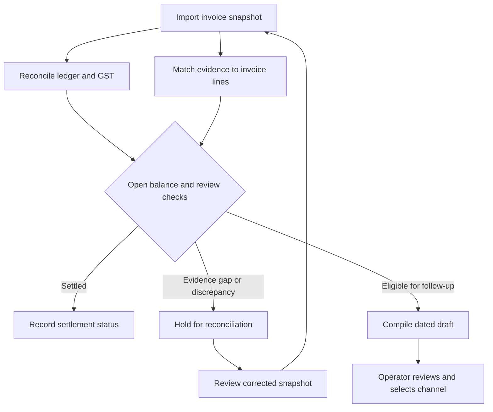

# ProofPay

ProofPay is a B2B receivables workbench for Indian accounts teams. It reconciles an invoice against payments and adjustments, traces disputed lines to delivery or service records, and prepares correspondence for review. Each decision retains the ledger entries, contract clauses and evidence references behind it.

[Quick start](#quick-start) · [Worked example](#worked-example) · [Technical architecture](#technical-architecture) · [Decision API](BACKEND.md) · [Build checks](https://github.com/pushkkal0201-bit/ProofPay/actions)

## Why and when to use it

An unpaid balance tells a collector how much is open. It takes a different set of records to establish whether the buyer received the full order, whether a credit note has cleared, and whether the tax figures agree. ProofPay brings these checks into the same invoice review.

| When | Who uses it | What they get |
| --- | --- | --- |
| A payment or credit note arrives after invoicing | Accounts receivable | A balance broken down by principal, tax, payments and approved notes. |
| A buyer disputes delivery or performance | Operations or a dispute reviewer | A line-by-line comparison of the contractual requirement, supporting records and outstanding questions. |
| Tax components differ between records | Finance or tax reviewer | The differing components alongside the supplied GSTR-2B statement and buyer master. |
| An overdue invoice is ready for follow-up | Credit controller | A dated draft tied to the reviewed invoice revision, with a separate interest estimate where applicable. |

## Worked example

Two synthetic invoices cover an order for two industrial pumps. In **PP-1042**, the receipt covers both units. The reviewer can open the cited receipt and check the calculation before approving a draft.

| Posting | Amount |
| --- | ---: |
| Invoice base | ₹1,50,000 |
| GST | + ₹27,000 |
| Payment received | − ₹40,000 |
| Approved credit note, including tax | − ₹5,900 |
| **Outstanding** | **₹1,31,100** |

In **PP-1043**, the receipt records one unit against two ordered. ProofPay keeps the balance visible and holds the whole-invoice draft. The reviewer can see which line needs a second receipt. [Complete receipt example](examples/PP-1042.json) · [Partial receipt example](examples/PP-1043.json)

## Quick start

Download and extract the repository. On Windows, open Command Prompt in the folder containing **Start-ProofPay.cmd**. The launcher uses Python 3.11, creates a project environment and starts the local server.

```bat
Start-ProofPay.cmd 8770
```

Open **http://127.0.0.1:8770/datum**. Select **Open audit ledger** and choose either worked example. The first launch loads seven synthetic invoices. Use **Import invoice** to load a JSON snapshot, or select **Export packet** to inspect the reviewed case packet.

On macOS or Linux, run the following from the repository root with Python 3.11–3.13:

```sh
python3 -m venv .venv
. .venv/bin/activate
python -m pip install -r requirements.txt
python -m proofpay --port 8770
```

**Input convention.** An import contains the entire invoice as of the assessment date. The example files express amounts in integer paise. Evidence references both the invoice ID and its line ID. Payments include the entire receipt amount in the base field, with zero GST. Copy an example under a new invoice ID to add a case, or import a revised snapshot under the existing ID to review a change.

## Review workflow



| Workspace | What happens there |
| --- | --- |
| **Audit Ledger** | Search invoices, compare open balances and inspect receipts, signatories, quantities and service telemetry beside the selected row. |
| **Tax reconciliation** | Expand CGST, SGST and IGST postings, examine approved or pending adjustments and compare the original invoice with an imported statement row. |
| **Statutory monitor** | Inspect the acceptance date, effective deadline and rate history. Adjust a projection while keeping the posted ledger and estimated interest separate. |
| **Resolution & dispatch** | Review a compiled notice, edit the text, prepare an email or WhatsApp handoff, or export a PDF. Revision checks tie actions to the selected case. |

## Technical architecture

The local workbench and the FastAPI decision service share the same accounting and evidence rules. The workbench serves the bundled React interface and stores invoice reviews in SQLite. The separate service accepts authenticated batch requests and writes versioned decisions to its own journal.

| Layer | Technology | Design choice |
| --- | --- | --- |
| Interface | React 18, strict TypeScript, Tailwind CSS, esbuild | A shared invoice selection connects the four screens. Bundled assets support local operation. |
| Input and calculation | Python, Pydantic v2, Decimal, integer paise | Schema validation precedes reconciliation. Exact arithmetic preserves posting-level precision. |
| Evidence and routing | Python domain services | The evidence checker returns line-level milestones and cited records. The escalation service combines review holds, due dates and payment status. |
| Integration | FastAPI, OpenAPI | Clients can submit batches, retrieve a decision revision and request correspondence for that revision. |
| Persistence and integrity | SQLite transactions, SHA-256, optional Ed25519 verification | Expected revisions detect stale writes. Idempotency keys support batch retries. Issuer public keys support signed evidence checks. |
| Automation | GitHub Actions, Python unittest, TypeScript compiler | CI exercises Python 3.11–3.13 and rebuilds the frontend to check the committed assets. |

## Repository guide

| Path | Contents |
| --- | --- |
| [frontend/src](frontend/src) | Typed ledger, evidence pane, tax reconciliation, statutory monitor and dispatch views |
| [proofpay/services](proofpay/services) | Ledger, evidence, tax compliance, escalation and decision journal |
| [proofpay/api.py](proofpay/api.py) | FastAPI application and versioned decision routes |
| [engine](engine) | Portfolio reconciliation, accrual schedules, notice formatting and packet exports |
| [examples](examples) | Seven runnable invoice snapshots |
| [tests](tests) | Accounting, evidence, API, concurrency and workbench regression checks |

## Command-line review

Run one invoice without opening the browser:

```sh
python -m proofpay --analyze examples/PP-1042.json
```

The result includes **LEDGER_SUMMARY**, **CAUSAL_ANCHOR**, **TRANSACTION_STRATEGY** and **COMMUNICATIONS_DRAFT**. For service setup, request examples, evidence signing and batch replay semantics, see the [backend integration guide](BACKEND.md).

## Development

```sh
python -m pip install -r requirements-test.txt
python -m unittest discover -s tests -v
npm ci --prefix frontend
npm run build --prefix frontend
```

Use Node.js 22 for frontend builds. The Python launcher serves the compiled files from the repository.
