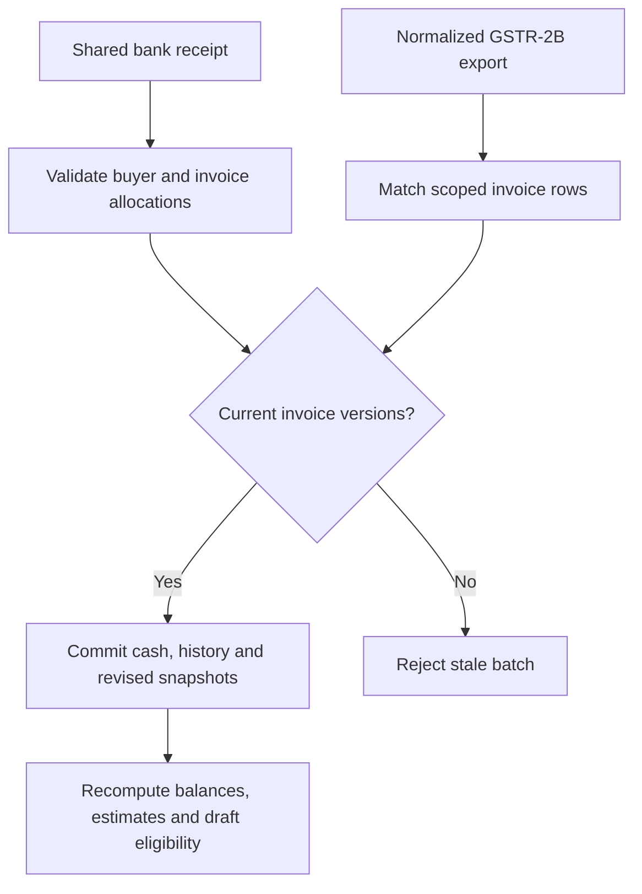
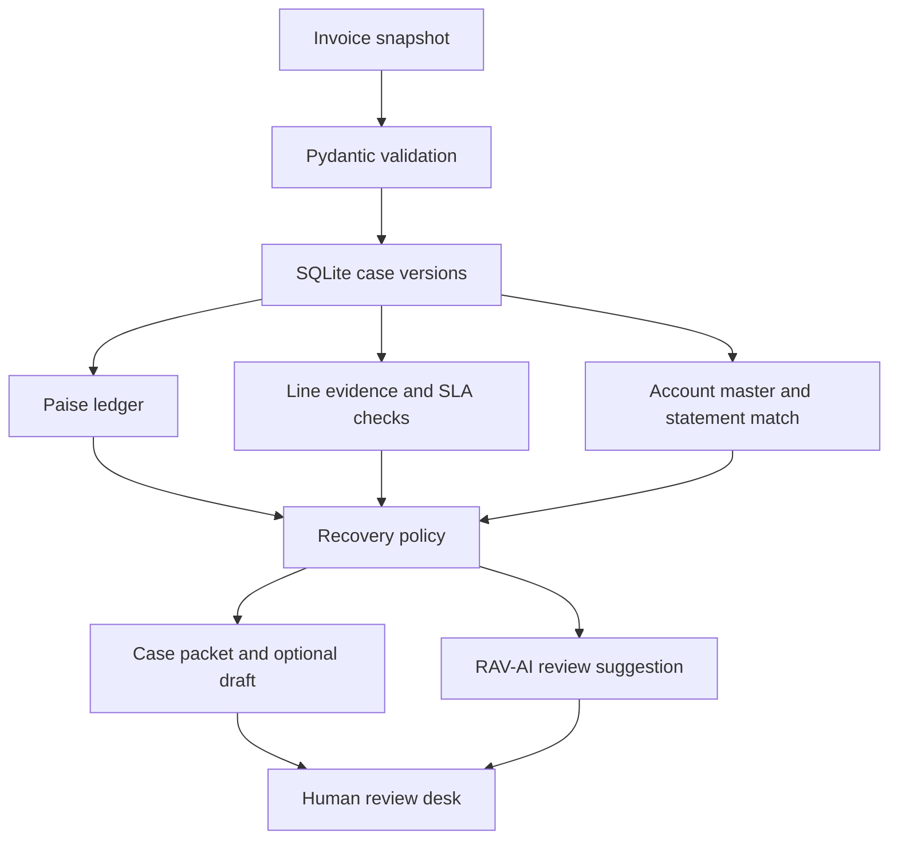
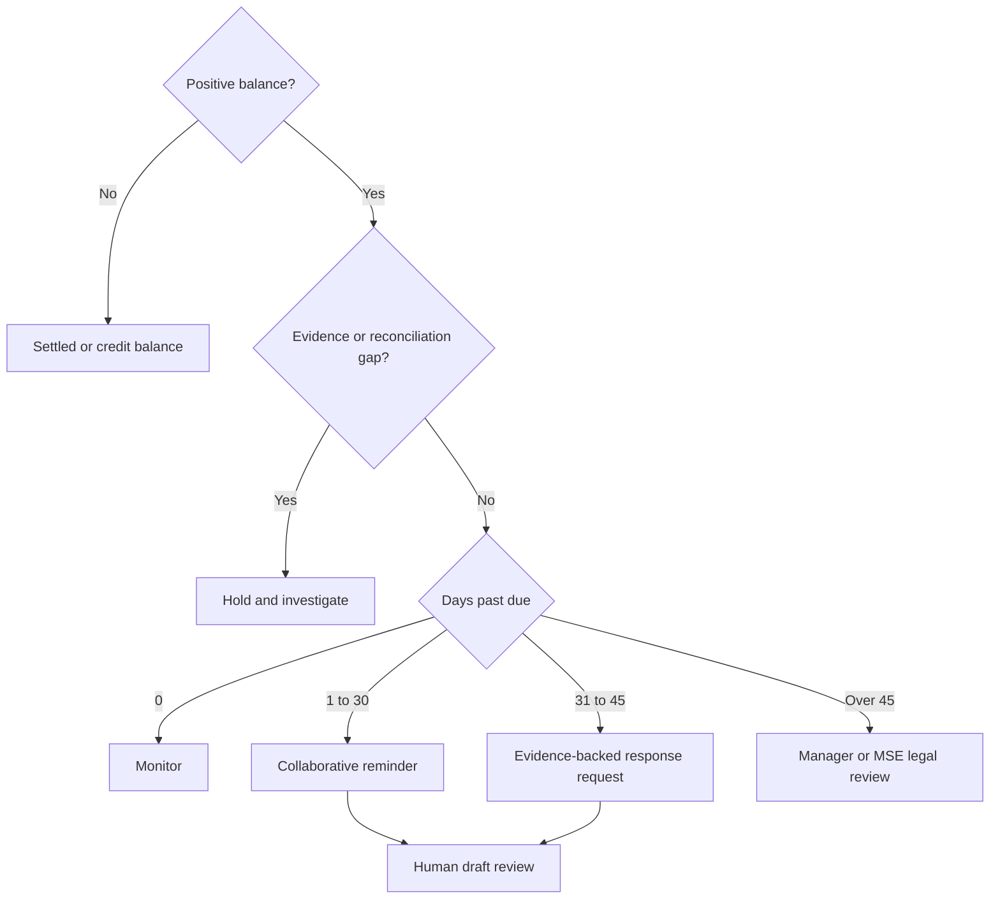

# ProofPay

**An evidence-first B2B receivables workbench for Indian invoices.** ProofPay reconciles an invoice, checks whether delivery or service records support its individual lines, and prepares a collection draft when those checks pass. RAV-AI suggests the next review task. A person decides what to send.

**Stack** · Python 3.11+ · FastAPI · Pydantic v2 · SQLite · React 18 · strict TypeScript · Tailwind CSS · optional local Ollama · GitHub Actions

## Backend decision API

The [FastAPI backend guide](BACKEND.md) includes Windows setup, an executable ingestion example, OpenAPI access, evidence signing, tax clocks, and the local throughput benchmark. The four services power both API and workbench decisions. Batched writes use an atomic journal with optimistic concurrency and replay protection. [Service implementations](proofpay/services) · [Edge-case tests](tests/test_services.py) · [Transaction and concurrency tests](tests/test_decision_api.py)

## Try it in two minutes

Extract the repository and open a terminal in the directory containing this README. On Windows Command Prompt:

```bat
py -3 -m venv .venv
.venv\Scripts\activate
python -m pip install -r requirements.txt
python -m proofpay
```

On macOS or Linux:

```sh
python3 -m venv .venv
source .venv/bin/activate
python -m pip install -r requirements.txt
python -m proofpay
```

Open **http://127.0.0.1:8765**. Seven synthetic cases load on first launch. The default demo runs without a model download, API key or account. Press Ctrl+C to stop. Use `--port` or `--db` to change the port or database.

### Recruiter walkthrough

1. Open **PP-1042 / Kaveri Machine Works**. The buyer asks whether both pumps arrived. Compare the PO clause, two units ordered, signed POD, receiving supervisor and timestamp. The supplied GSTR-2B row also matches the original invoice.
2. Read the matrix. ₹1,50,000 principal + ₹27,000 GST − ₹40,000 received − ₹5,900 credit = **₹1,31,100 outstanding**. At 41 DPD the proposed letter cites POD-817 and requests a response by 7 November 2026.
3. Open **PP-1043 / Nilgiri Components**. The receipt covers one of two units. A missing unit blocks the whole-invoice draft. **PP-1046 / Malabar Cloud Services** shows a different failure mode: measured uptime exceeds the target, yet the specific complaint still needs investigation.
4. Compare **PP-1044** (manager review after 45 days) and **PP-1045** (early reminder). Select **Ask RAV-AI**, review an eligible draft, then export the case packet as JSON. Reopen the workbench to see the saved review.
5. To demonstrate a revision, copy PP-1042 from the examples folder, change the statement row’s GST by one paisa and import the edited file. Confirm the revision. The case moves to review hold, the old approval no longer applies, and the portfolio still counts that invoice once.

Each example uses a fixed assessment date so the same input gives the same answer during an interview.

## The reviewer workbench

The Python server serves a prebuilt React client. The four workspaces share the active invoice. Press **1–4** to switch screens, **J/K** or **↓/↑** to move across filtered invoices and **/** to search. Shortcuts suspend while typing. Use Tab and Enter to expand invoice rows and inspect attachments.

| Screen | Inspect or act |
| --- | --- |
| Causal chain | Expand invoice lines or open the execution pane. Compare signatories, e-way records and uptime; inspect stored verification JSON, source hashes, signed-note crops and OCR text. PP-1047 includes a labeled synthetic scan and its actual OCR transcription. |
| Tax ledger | Expand original lines and approved/pending postings. PP-1049 has a debit note, an overdue payment-age review flag and a statement tax-component mismatch despite matching gross GST. |
| Statutory monitor | Compare acceptance, agreed due date and effective due date. Change the assumed future bank rate and scrub or play the 30-day estimate. Historical rates and the posted ledger stay authoritative. Playback advances one scenario day per second. |
| Communications | Compare the engine payload with a manually edited channel draft. Edits persist within the browser session by snapshot and channel. Export the edited PDF, an unsent email file or a WhatsApp JSON body to complete in an authorized client. Every export rechecks channel eligibility and snapshot identity. |

To rebuild the committed assets with Node 22+:

```sh
cd frontend
npm ci
npm run build
```

The source is in [frontend/src](frontend/src). A normal Python launch uses the compiled bundle without a Node runtime or CDN connection. Existing databases keep previous case versions. To see the bundled signed crop on an older installation, import the updated [PP-1047 snapshot](examples/PP-1047.json) or launch with a fresh demo database.

## Featured case · MSE delayed payment

Open **PP-1047** and expand **Tax split and interest audit**. The reviewed acceptance date is 27 August. The written due date is 24 October, but the 45-day ceiling moves the effective due date to **11 October**. On the 15 December snapshot, the invoice is **65 days past due**. The case holds **₹1,31,100** in open receivables and a separate **₹4,784.28** interest estimate. Expand the table to see how a ₹40,000 payment and a change in the illustrative bank rate affect different periods. Download the review PDF or inspect the opt-in WhatsApp draft.

**What the legal clock measures.** For a confirmed eligible micro or small supplier, the engine uses a reviewer-confirmed acceptance or deemed-acceptance date. With a written agreement, it takes the earlier of the agreed date and acceptance plus 45 days. Without a written agreement it uses acceptance plus 15 days, with interest starting the following day. A timely written objection can affect the acceptance date; a reviewer must resolve that before supplying the date. The 46-DPD escalation is an internal routing policy. A reference to the MSE Facilitation Council requires a separate decision. [MSMED Act, sections 2(b), 15, 16 and 18](https://upload.indiacode.nic.in/showfile?actid=AC_CEN_46_77_00002_200627_1517807324919&filename=msmed_act%2C_2006_scan.pdf&type=notification)

**Interest method.** All posted money uses integer paise. Estimation uses decimal arithmetic on the reviewed open gross amount, Actual/365, beginning-of-day postings and calendar-month-end rests. For MSE estimates the multiplier is three times the effective-dated bank rate; contract estimates use the reviewed annual rate and simple interest. The final estimate rounds half-up to paise. These day-count, payment-allocation and rest conventions require verification against the agreement and any adjudicated computation. The example rates are synthetic. The operator must supply a complete rate history with source references. Missing start coverage blocks escalation. The engine assumes the last supplied rate continues until superseded. Interest payments and adjudicated awards need separate reconciliation.

**Tax reconciliation.** CGST, SGST and IGST are stored separately on invoice lines and approved notes. Unspecified legacy splits remain visible as unallocated. A normalized recipient GSTR-2B export can refresh an entire scoped batch; matching checks both GSTINs, invoice ID, date, taxable value and tax components. Duplicate candidate rows halt the batch for amendment review. An absent row clears the prior match for that invoice. GSTR-2B is an auto-drafted statement; the tax team decides ITC treatment. [GST Portal GSTR-2B FAQ](https://tutorial.gst.gov.in/userguide/returns/FAQ_gstr2b.htm)

### Reproduce the adapters

```sh
python -m proofpay --analyze examples/PP-1047.json
python -m proofpay --batch tests/data/portfolio.json --statement tests/data/statement.csv
python -m proofpay --parse-proof tests/data/receipt.txt
python -m proofpay --profile tests/data/profile.json
```

- **Portfolio reconciliation** allocates one bank receipt across two invoices, retains unapplied cash and returns revised, importable sources. Only explicit allocations are used. The CLI is a simulation; `POST /api/portfolio` commits the same operation in SQLite.
- **Proof extraction** recognizes labeled lines in fulfillment text, preserves invoice/line references and normalizes timestamps. A signed receipt can support delivery; an e-way record alone supports transit. Parser results enter review as unverified candidates. OCR and signature authentication require additional integrations.
- **Compact profile intake** supports the rupee-denominated sample payload. Its reported balance is ₹1,67,000. Its missing due date, approved postings and line links produce an intake hold. Use the full case schema to enable drafting.
- **Channel control** withholds drafts if contact is paused. WhatsApp requires explicit opt-in. Email follows the account preference. The packet carries the operator's daytime IST contact window for downstream review. All delivery, filing and external reporting remain manual.

### Deterministic output contract

| Section | Contents |
| --- | --- |
| `LEDGER_SUMMARY` | Adjusted tax components, approved debits/credits, cash, open balance, payment history, DPD, effective deadline and a separate interest schedule |
| `CAUSAL_ANCHOR` | Line IDs, clauses, cited records, signatories, timestamps and evidence gaps |
| `TRANSACTION_STRATEGY` | Selected tier, required action and hold reasons |
| `COMMUNICATIONS_DRAFT` | Channel-specific text, PDF availability, review status and configured contact window |



## Architecture



## Recovery decision



## What the checks establish

| Area | Implemented rule | Boundary |
| --- | --- | --- |
| Money | Integer paise, approved debits increase the balance, approved credits and cash reduce it. Excess cash is preserved as a credit balance. | Input GST is supplied by accounting. Interest defaults to zero. |
| Adjustments | Credit and debit records have separate base and GST amounts, posting date, reference ID and approval status. Pending adjustments hold the case. | Approval is supplied by the operator. Statutory note validity needs independent review. |
| Delivery | A reviewed POD or BOL must match both invoice and line, identify the signer and cover the full quantity. | Inputs are attestations. Optional text attachments have an integrity check and can be opened in the dashboard. Original-document authentication, OCR and aggregation of partial receipts are outside this version. |
| Services | Signed acceptance plus period-matched telemetry where the contract specifies an uptime target. Metrics use basis points. Conflicting below-target telemetry triggers review. | Reviewer attests contract-period coverage. A performance objection remains open until resolved. |
| GST | Checks GSTIN shape and exact buyer-name/ID match against an imported master. An optional original-invoice GSTR-2B snapshot is checked against supplier, recipient, invoice ID, date, principal and GST. | Master and statement are offline snapshots. An absent statement is displayed as unavailable. This is neither live GSTN verification nor a filing-status determination. |
| ITC | A separate invoice-age clock flags outstanding non-reverse-charge invoices at 180 days for tax review. | The reviewer must assess applicability, ITC actually availed, partial payment and exceptions. No automatic penalty or reversal amount. |
| Outreach | 1–30 DPD gets a seven-day response request. 31–45 DPD gets a two-calendar-day response request. Later cases require a manager. | All correspondence is draft-only. No automatic messaging, suspension, legal referral or bureau reporting. |

**Policy source:** [Central Goods and Services Tax Act, sections 16 and 34 (India Code)](https://www.indiacode.nic.in/indiacode/bitstream/123456789/15689/1/A2017-12.pdf). The demo is scoped to Indian B2B receivables and does not implement US collection or telemarketing compliance.

## RAV-AI and payment instructions

For opt-in hosted inference, set `PROOFPAY_PROVIDER=openai`, `PROOFPAY_MODEL` to an available Chat Completions model supporting JSON and temperature, and `ENGINE_API_KEY` in the server environment. This sends the objection and selected read-only accounting views to OpenAI. Keep credentials outside the repository. The adapter constrains responses to the same tool/action vocabulary used locally. Both providers request temperature 0.15. [OpenAI API reference](https://platform.openai.com/docs/api-reference/chat/create)

In default **policy** mode, the next-task suggestion is deterministic. To exercise the language-model path, run Ollama locally with an installed chat model. Set `PROOFPAY_MODEL` to its exact installed name before starting ProofPay. For example, in Windows CMD use `set PROOFPAY_MODEL=your-installed-model-name`. On Linux/macOS use `export PROOFPAY_MODEL=your-installed-model-name`.

In Ollama mode the adapter sends the objection and check outcomes to the [local chat endpoint](https://docs.ollama.com/api/chat). The agent chooses read-only ledger, GST or evidence inspections, receives their results and then selects an allowed review task. The UI exposes the tool trace. Repeated tools and final decisions without an inspection are rejected. Each investigation has a four-call limit. A timeout, malformed response or disallowed action returns a visible error. The model cannot set balances, approve evidence, invent deadlines or send a message. The deployed prompt is in [system_prompt.txt](system_prompt.txt).

An operator can set `PROOFPAY_REMITTANCE` to a verified payment instruction before launch. The app includes that exact text in eligible drafts. Use synthetic details for demonstrations. With this setting empty, drafts refer to the parties’ previously agreed instructions. Changing draft wording changes the review key.

## Integration and validation

```sh
python -m proofpay --analyze examples/PP-1042.json
python -m pip install -r requirements-test.txt
python -m unittest discover -s tests -v
```

| Route | Purpose |
| --- | --- |
| POST /api/portfolio | Atomic posting. Send versions (invoice → review_key), payments and optional statement_csv. A conflict returns 409. Check unapplied_cash in the response. |
| POST /api/profile | Triage the compact input structure with rupee-denominated fields |
| POST /api/parse-proof | Submit a text field for candidate extraction |
| POST /api/notice | Submit invoice and review_key to download a draft PDF |
| GET /api/schema | JSON Schema for invoice imports |
| GET /api/cases | Analyzed snapshots, source data and review status |
| POST /api/cases | Validate and insert a unique invoice snapshot |
| POST /api/revise | Submit source and current review_key, archive previous snapshot atomically |
| POST /api/agent | Submit invoice ID in the invoice field for a next-task suggestion |
| POST /api/review | Mark the exact eligible draft reviewed using invoice and review_key |

POST requests accept JSON. From the terminal, use the loopback host and port. Start with [the complete sample input](examples/PP-1042.json). Entry amounts are tax-exclusive except payments, whose full amount belongs in base with zero GST. Reviewed evidence must include a timestamp with a timezone. Each import is a complete cumulative snapshot. An export wraps the importable input under `source`.

### Engineering choices worth discussing

- **Deterministic money and policy.** The same snapshot, configuration and policy yield the same financial matrix and draft. This makes threshold and ledger regressions testable.
- **Conservative dispute handling.** Evidence can support delivery while leaving a quality complaint unresolved. Each line retains its contract clause, cited records and gaps.
- **Revision-safe reviews.** SQLite transactions serialize revisions and review writes. The SHA-256 review key binds a snapshot and its draft; stale approvals are rejected. This content hash identifies the reviewed version and does not authenticate an underlying document.
- **Small deployment surface.** A single Python process serves both UI and API. Tests exercise the real HTTP server, SQLite persistence and mocked model responses. The CI workflow runs the suite on Python 3.11–3.13.

## Repository map

| Path | Responsibility |
| --- | --- |
| engine/ | Interest schedules, policy inputs, batch posting, tax import, proof parser, packet and PDF renderer |
| tests/data/ | Annotated example inputs for the CLI adapters |
| proofpay/models.py | Typed input contract and validation |
| proofpay/engine.py | Evidence, GST, balances and strategy |
| proofpay/agent.py | Local model adapter and policy fallback |
| proofpay/__main__.py | CLI, HTTP API and SQLite storage |
| proofpay/static/ | Investigator dashboard |
| examples/ | Seven synthetic invoice snapshots |
| tests/test_recovery.py | Accounting, policy, API and adapter regression tests |
| .github/workflows/checks.yml | Continuous integration |

## Operating scope

This is a single-user, loopback-only portfolio application. Use synthetic records for demos. A real deployment would need identity and access control, credential-managed ERP and tax integrations, original evidence storage, tamper-resistant audit logging, jurisdiction-specific policy review and an authorized communications workflow. The examples demonstrate decision behavior; they provide no measured recovery-rate or cash-flow uplift.

## Source and checks

[GitHub repository](https://github.com/pushkkal0201-bit/ProofPay) · [Continuous integration](https://github.com/pushkkal0201-bit/ProofPay/actions)
