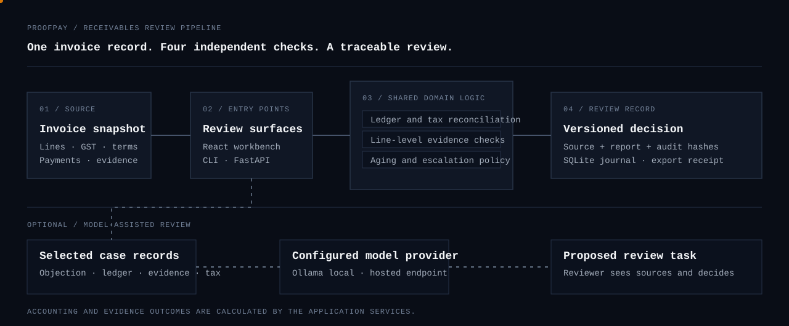
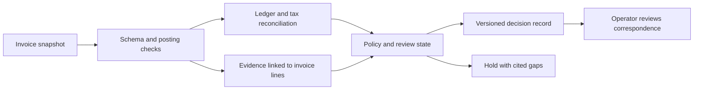
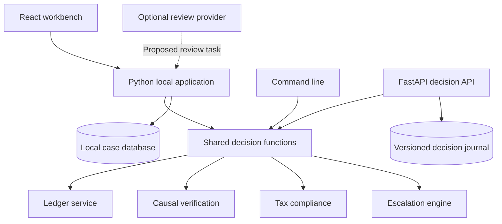

# ProofPay

**Receivables review, with each balance tied to its ledger postings and each disputed line tied to its source evidence.**

ProofPay is a B2B accounts-receivable workbench for invoice reconciliation, delivery and service verification, GST comparison, statutory date tracking, and correspondence preparation. It gives finance and operations reviewers one case record to inspect before they decide what to do with an overdue account.

<p align="center">
  
</p>

<p align="center"><sub>Data moves from an invoice snapshot through deterministic checks into a versioned review record. The optional model review is a separate, read-only path.</sub></p>

[Problem and approach](#the-problem) · [Workflow](#how-a-case-moves-through-proofpay) · [Quick start](#run-the-workbench) · [Architecture](#technical-design) · [Try the examples](#review-the-included-cases) · [Decision API](BACKEND.md)

## The problem

Receivables work often spans several records: an invoice, cash postings, credit or debit notes, a delivery receipt, an e-way bill, a service report, a buyer tax statement, and the payment terms. A balance can be arithmetically correct while a delivery line remains disputed. A delivery record can be complete while a credit note or tax split is still unreconciled. Reviewing each item in isolation makes it difficult to explain why a case is ready for follow-up or why it should stay on hold.

ProofPay brings those records together at invoice-line level. It calculates the open amount from posted entries, matches submitted fulfillment evidence to the relevant contract line, reports tax and payment-window observations separately, and records the checks that drive the next review state. A reviewer can follow the result back to the records used to produce it.

## What ProofPay does

| Work area | Input | Result |
| --- | --- | --- |
| Ledger reconciliation | Invoice lines, payments, approved credit notes, debit notes, tax splits | Principal, tax, adjustments, payments, and net balance in integer paise |
| Fulfillment review | POD, BOL, service acceptance, e-way records, telemetry, optional signature and coordinates | Per-line milestone table with supporting evidence IDs, conflicts, and gaps |
| GST review | Buyer master, supplier and recipient GSTINs, tax split, supplied GSTR-2B row, place of supply | Master and statement match results, tax-regime observation, and payment-window status |
| Due-date and interest review | Contract terms, acceptance date, registration status, rate schedule, ledger dates | Effective due date, DPD bucket, statutory clock, and a separate interest estimate |
| Resolution preparation | Reviewed invoice revision and selected output channel | Editable correspondence text, WhatsApp payload, or PDF export for operator review |

ProofPay reports the supplied records and calculated checks. A `Matched` tax statement is a comparison result; it is not a certification of a buyer’s ITC entitlement. Statutory dates and interest depend on verified facts and terms entered for the case.

## How a case moves through ProofPay

The same domain analysis is used by the local workbench, command line, and decision API.



### Review sequence

1. **Load a complete invoice snapshot.** Each snapshot includes invoice lines, due and assessment dates, ledger postings, tax data, any dispute, and evidence references. Re-importing a known invoice creates a reviewable revision in the workbench.
2. **Validate the record.** Pydantic schemas reject malformed identifiers, dates, tax splits, amounts, duplicate IDs, unsupported evidence values, invalid image crops, and inconsistent payment entries before calculation.
3. **Reconcile money.** Decimal arithmetic produces integer paise for the wire format. Approved payments and credit notes reduce the balance; approved debit notes increase it. Tax components are checked against their posted totals.
4. **Evaluate each contractual line.** Evidence must reference the invoice and line. The verifier checks the required receipt or acceptance, quantities, optional period-matched service telemetry, delivery-zone coordinates, attachment checksums, and configured Ed25519 signatures.
5. **Compare tax and terms.** The tax service checks supplied master and statement records. The escalation engine evaluates due dates, aging, review holds, and an estimate from the configured terms and rate history.
6. **Record the review result.** The workbench stores local case revisions in SQLite. The decision API stores source snapshots, reports, event hashes, and export receipts in a separate journal.
7. **Prepare a communication.** A reviewer inspects and edits the generated text before creating the chosen output. Held or stale decisions cannot be compiled as ready correspondence through the decision API.

## Run the workbench

### Windows

Install Python 3.11, download the repository ZIP from GitHub, and extract it. In Command Prompt, change to the extracted repository directory—the one containing `Start-ProofPay.cmd`—then run:

```bat
Start-ProofPay.cmd 8770
```

The launcher creates `.venv`, installs `requirements.txt`, and starts the local server. Open [http://127.0.0.1:8770/datum](http://127.0.0.1:8770/datum). Keep the Command Prompt window open while using the workbench. Press **Ctrl+C** in that window to stop it.

If Python 3.11 is installed but `py -3.11` is not recognized, use the Python Launcher command `py -0p` to see installed versions. The launcher currently requests Python 3.11 by version.

### macOS and Linux

From the repository root, use Python 3.11, 3.12, or 3.13 in a virtual environment:

```sh
python3 -m venv .venv
. .venv/bin/activate
python -m pip install -r requirements.txt
python -m proofpay --port 8770
```

Open [http://127.0.0.1:8770/datum](http://127.0.0.1:8770/datum). The local workbench starts with seven synthetic invoice cases. No ERP connection is needed to inspect the examples or import a JSON snapshot.

## Review the included cases

Open **Audit Ledger**, select an invoice, and expand its evidence or tax records. The case list is designed to show different outcomes rather than seven identical successful collections.

| Invoice | Review scenario | What to check |
| --- | --- | --- |
| `PP-1042` | Complete receipt with payment and approved credit note | Reconcile the original invoice to the remaining balance and fulfillment record. |
| `PP-1043` | One unit received against two invoiced | Find the quantity gap and confirm the correspondence remains held. |
| `PP-1044` | Aged balance routed for manager review | Inspect aging, terms, and review state. |
| `PP-1045` | Early-stage reminder | Confirm the receipt and the dated request for a payment date. |
| `PP-1046` | Service performance dispute | Compare the contract target with the supplied telemetry period. |
| `PP-1047` | MSE terms and matched statement row | Inspect the separate interest estimate, terms inputs, and fulfillment records. |
| `PP-1049` | Tax-component discrepancy | Compare the line tax split with the supplied statement row. |

The sample records are synthetic and intended for local review. They do not represent actual buyers, GST filings, payment terms, or rate notifications.

### Test an imported invoice

Use a copy of an example JSON file. Change the invoice ID, buyer, dates, line references, and evidence references together. Keep amounts as whole-number paise or as quoted INR strings with at most two decimal places; do not use JSON floating-point amounts. Import the revised file from **Import invoice**.

For a quick command-line review from the repository root:

```sh
python -m proofpay --analyze examples/PP-1042.json
```

The output contains `LEDGER_SUMMARY`, `CAUSAL_ANCHOR`, `TRANSACTION_STRATEGY`, and `COMMUNICATIONS_DRAFT`. For the exact source schema, see `proofpay/models.py` and the example JSON files.

## Technical design



The workbench and the API have separate storage lifecycles. Importing a case into the browser-based local workbench does not publish it to the API journal.

| Component | Implementation | Responsibility |
| --- | --- | --- |
| Frontend | React 18, TypeScript, Tailwind CSS 3, esbuild | Four dense review screens, invoice selection, keyboard navigation, editable correspondence and local case actions |
| Input contract | Pydantic v2 models | Strict invoice, line, ledger, tax, terms, evidence, signature, and image-crop structures |
| Ledger | Python `Decimal`, integer paise on JSON boundaries | Exact amount reconciliation across original lines and approved entries |
| Causal verification | Python domain service, SHA-256, Ed25519 | Invoice-line evidence matching, milestone truth tables, optional issuer signature validation, and explicit gaps |
| Tax compliance | GSTIN pattern and record comparisons | Buyer-master and statement comparison, tax split checks, place-of-supply observation, payment-window status |
| Escalation | Effective-dated rate schedule and date calculations | DPD, statutory clock, review tier, and interval-based interest estimate kept apart from principal and tax |
| Local persistence | SQLite | Workbench case snapshots and local review state |
| Decision API | FastAPI, SQLite WAL, bearer credentials | Authenticated batch evaluation, revision checks, idempotent retries, audit records, and revision-bound exports |
| Model review | Ollama locally or configured OpenAI endpoint | Optional read-only inspection of selected case records that returns a proposed review task |

### Ledger and evidence rules

- Every amount in an imported record is expressed in INR paise or a decimal string. Calculations use `Decimal`; the JSON decision contract returns integer paise.
- A payment entry records the cash amount in `base` and uses `gst: 0`. Approved entries affect the collectible balance; unapproved notes remain visible for review without changing it.
- Evidence is associated with both an invoice ID and a line ID. A goods line requires one qualifying POD/BOL record with a recorded recipient and coverage of the full invoiced quantity. When a line sets `require_signature`, the issuer’s configured cryptographic signature must also verify. Multiple partial records are not silently summed to satisfy the quantity check.
- Service lines can require period-matched telemetry meeting the line’s uptime target. A recorded performance dispute can still require reviewer resolution even when the metric passes.
- An evidence signature is checked against a configured issuer key, source name, and permitted evidence kinds. The signed canonical payload binds the invoice, line, timestamp, source, and assertion fields. A valid signature confirms the issuer’s signed assertion; the reviewer still evaluates the underlying claim.
- Optional image crops are validated as PNGs and checked against their SHA-256 digest. Text attachments also carry a digest and can be checked for conflicting invoice, line, signer, and quantity fields.

### Tax and statutory calculations

The tax processor distinguishes the supplied GSTR-2B-style row match from the payment-window observation. It compares invoice identifiers, dates, supplier and recipient registrations, original principal and GST, and a provided tax split where present. The expected statement date is an input; the processor does not fetch government filings.

GST regime classification uses a supplied supplier GSTIN, place of supply, and SEZ flag. Missing or invalid source facts remain unresolved. GST treatment can depend on transaction-specific rules, so the calculated match and regime should be read alongside the source records.

The escalation engine uses the reviewed effective due date and terms. For MSE interest, the case must include the relevant acceptance, agreed terms, authority reference, enterprise status, and effective-dated rate schedule. The implementation calculates an estimate using documented day-count and monthly-rest conventions; it keeps that estimate separate from posted principal, GST, payments, and notes. See [BACKEND.md](BACKEND.md#source-fields-and-legal-clocks) for the input assumptions.

## Optional dispute review with Ollama

The **Dispute review** workspace can send the buyer’s objection and selected accounting, tax, or delivery records to a configured model. It presents the provider, inspection steps, and proposed task. The ledger reconciliation, tax comparison, evidence checks, and correspondence eligibility come from the application’s domain rules.

To run a local Qwen model, install and start [Ollama](https://ollama.com/download/windows), then download the model in Command Prompt:

```bat
ollama pull qwen2.5:3b
```

Stop an existing ProofPay server with **Ctrl+C**. In a new Command Prompt at the repository root, run:

```bat
Start-Model-Review.cmd
```

Enter `qwen2.5:3b` when prompted. Open [http://127.0.0.1:8770/workbench](http://127.0.0.1:8770/workbench), select `PP-1043`, and choose **Run model review** below the workspace. The case is held because the receipt quantity does not cover the full invoice line; use the expanded **Delivery evidence**, **Financial ledger**, and **Tax records** sections to inspect the records sent for review.

For another installed model, enter its exact name from `ollama list`. On macOS or Linux, set `PROOFPAY_PROVIDER=ollama` and `PROOFPAY_MODEL` before starting the server. Hosted review can be configured with `PROOFPAY_PROVIDER=openai`, `PROOFPAY_MODEL`, and `ENGINE_API_KEY`. With the hosted option, the objection and selected record views are sent to the configured provider; keep credentials in the server environment.

## Decision API

The FastAPI service is intended for controlled integration from an ERP export, batch job, or internal finance tool. It is separate from the local demo workbench and requires configured operator bearer credentials. Its routes accept versioned invoice snapshots, return reproducible reports, expose a read-only clock projection, and compile revision-bound Markdown, WhatsApp JSON, or PDF output.

The journal records input and output digests, revision, actor, request key, assessment date, previous event hash, and export receipts. Stale writes and reused idempotency keys with different content are rejected. See the [API guide](BACKEND.md) for setup, request examples, evidence signing, statutory inputs, route contracts, and transaction behavior.

## Repository map

| Path | Purpose |
| --- | --- |
| `frontend/src/` | Typed React workbench screens and shared interface components |
| `proofpay/models.py` | Invoice, tax, terms, ledger, and evidence input models |
| `proofpay/services/ledger.py` | Exact reconciliation of invoice postings |
| `proofpay/services/causal.py` | Evidence matching and issuer signature checks |
| `proofpay/services/tax.py` | GST and payment-window comparisons |
| `proofpay/services/escalation.py` | Aging, decision tier, and statutory clock |
| `proofpay/services/journal.py` | Versioned source and decision journal |
| `proofpay/api.py` | Authenticated FastAPI routes |
| `engine/` | Shared policy, accrual, packet, formatting, and workbench logic |
| `examples/` | Seven synthetic case snapshots |
| `tests/` | Unit and integration coverage for reconciliation, evidence, API, and workbench behavior |
| `docs/` | Repository diagrams and supporting documentation |

## Build and checks

Python dependencies:

```sh
python -m pip install -r requirements-test.txt
python -m unittest discover -s tests -v
```

Frontend dependencies and production bundle:

```sh
npm ci --prefix frontend
npm run build --prefix frontend
```

The frontend build runs TypeScript type-checking before bundling. The GitHub Actions workflow runs the Python checks across its configured Python versions and builds the frontend. Use Node.js 22 for local frontend builds.

## Project details

- **Application:** ProofPay
- **Domain:** B2B accounts receivable, fulfillment evidence, GST reconciliation
- **Primary currency:** INR
- **Interface:** English, local workbench
- **Repository:** [pushkkal0201-bit/ProofPay](https://github.com/pushkkal0201-bit/ProofPay)
