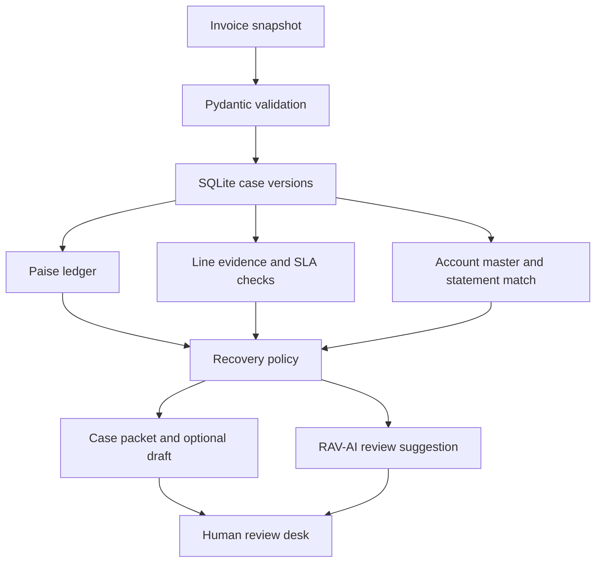
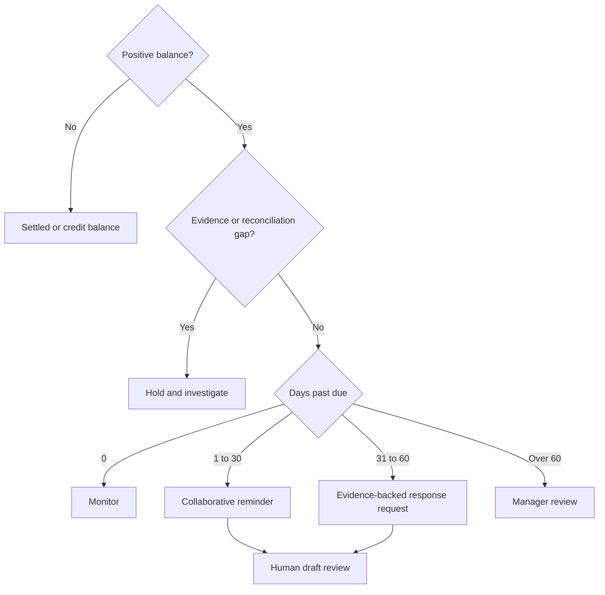

# ProofPay

**An evidence-first B2B receivables workbench for Indian invoices.** ProofPay reconciles an invoice, checks whether delivery or service records support its individual lines, and prepares a collection draft when those checks pass. RAV-AI suggests the next review task. A person decides what to send.

**Stack** · Python 3.11+ · Pydantic v2 · SQLite · vanilla JavaScript · optional local Ollama · GitHub Actions

## Try it in two minutes

Extract the repository and open a terminal in the directory containing this README. On Windows Command Prompt:

```bat
py -3 -m venv .venv
.venv\Scripts\activate
python -m pip install -r requirements.txt
python -m proofpay
```

On macOS or Linux:

```sh
python3 -m venv .venv
source .venv/bin/activate
python -m pip install -r requirements.txt
python -m proofpay
```

Open **http://127.0.0.1:8765**. Five synthetic cases load on first launch. The default demo runs without a model download, API key or account. Press Ctrl+C to stop. Use `--port` or `--db` to change the port or database.

### Recruiter walkthrough

1. Open **PP-1042 / Kaveri Machine Works**. The buyer asks whether both pumps arrived. Compare the PO clause, two units ordered, signed POD, receiving supervisor and timestamp. The supplied GSTR-2B row also matches the original invoice.
2. Read the matrix. ₹1,50,000 principal + ₹27,000 GST − ₹40,000 received − ₹5,900 credit = **₹1,31,100 outstanding**. At 41 DPD the proposed letter cites POD-817 and requests a response by 7 November 2026.
3. Open **PP-1043 / Nilgiri Components**. The receipt covers one of two units. A missing unit blocks the whole-invoice draft. **PP-1046 / Malabar Cloud Services** shows a different failure mode: measured uptime exceeds the target, yet the specific complaint still needs investigation.
4. Compare **PP-1044** (manager review after 60 days) and **PP-1045** (early reminder). Select **Ask RAV-AI**, review an eligible draft, then export the case packet as JSON. Reopen the workbench to see the saved review.
5. To demonstrate a revision, copy PP-1042 from the examples folder, change the statement row’s GST by one paisa and import the edited file. Confirm the revision. The case moves to review hold, the old approval no longer applies, and the portfolio still counts that invoice once.

The examples use a fixed assessment date, **5 November 2026**, so the same input gives the same answer during an interview.

## Architecture



## Recovery decision



## What the checks establish

| Area | Implemented rule | Boundary |
| --- | --- | --- |
| Money | Integer paise, approved debits increase the balance, approved credits and cash reduce it. Excess cash is preserved as a credit balance. | Input GST is supplied by accounting. Interest defaults to zero. |
| Adjustments | Credit and debit records have separate base and GST amounts, posting date, reference ID and approval status. Pending adjustments hold the case. | Approval is supplied by the operator. Statutory note validity needs independent review. |
| Delivery | A reviewed POD or BOL must match both invoice and line, identify the signer and cover the full quantity. | Inputs are attestations. Optional text attachments have an integrity check and can be opened in the dashboard. Original-document authentication, OCR and aggregation of partial receipts are outside this version. |
| Services | Signed acceptance plus period-matched telemetry where the contract specifies an uptime target. Metrics use basis points. Conflicting below-target telemetry triggers review. | Reviewer attests contract-period coverage. A performance objection remains open until resolved. |
| GST | Checks GSTIN shape and exact buyer-name/ID match against an imported master. An optional original-invoice GSTR-2B snapshot is checked against supplier, recipient, invoice ID, date, principal and GST. | Master and statement are offline snapshots. An absent statement is displayed as unavailable. This is neither live GSTN verification nor a filing-status determination. |
| ITC | A separate invoice-age clock flags outstanding non-reverse-charge invoices at 180 days for tax review. | The reviewer must assess applicability, ITC actually availed, partial payment and exceptions. No automatic penalty or reversal amount. |
| Outreach | 1–30 DPD gets a seven-day response request. 31–60 DPD gets a two-calendar-day response request. Later cases require a manager. | All correspondence is draft-only. No automatic messaging, suspension, legal referral or bureau reporting. |

**Policy source:** [Central Goods and Services Tax Act, sections 16 and 34 (India Code)](https://www.indiacode.nic.in/indiacode/bitstream/123456789/15689/1/A2017-12.pdf). The demo is scoped to Indian B2B receivables and does not implement US collection or telemarketing compliance.

## RAV-AI and payment instructions

In default **policy** mode, the next-task suggestion is deterministic. To exercise the language-model path, run Ollama locally with an installed chat model. Set `PROOFPAY_MODEL` to its exact installed name before starting ProofPay. For example, in Windows CMD use `set PROOFPAY_MODEL=your-installed-model-name`. On Linux/macOS use `export PROOFPAY_MODEL=your-installed-model-name`.

The adapter sends the objection and check outcomes to the [local chat endpoint](https://docs.ollama.com/api/chat). The agent chooses read-only ledger, GST or evidence inspections, receives their results and then selects an allowed review task. The UI exposes the tool trace. Repeated tools and final decisions without an inspection are rejected. Each investigation has a four-call limit. A timeout, malformed response or disallowed action returns a visible error. The model cannot set balances, approve evidence, invent deadlines or send a message. The prompt is in [SYSTEM_PROMPT.md](SYSTEM_PROMPT.md).

An operator can set `PROOFPAY_REMITTANCE` to a verified payment instruction before launch. The app includes that exact text in eligible drafts. Use synthetic details for demonstrations. With this setting empty, drafts refer to the parties’ previously agreed instructions. Changing draft wording changes the review key.

## Integration and validation

```sh
python -m proofpay --analyze examples/PP-1042.json
python -m unittest discover -s tests -v
```

| Route | Purpose |
| --- | --- |
| GET /api/schema | JSON Schema for invoice imports |
| GET /api/cases | Analyzed snapshots, source data and review status |
| POST /api/cases | Validate and insert a unique invoice snapshot |
| POST /api/revise | Submit source and current review_key, archive previous snapshot atomically |
| POST /api/agent | Submit invoice ID in the invoice field for a next-task suggestion |
| POST /api/review | Mark the exact eligible draft reviewed using invoice and review_key |

POST requests accept JSON. From the terminal, use the loopback host and port. Start with [the complete sample input](examples/PP-1042.json). Entry amounts are tax-exclusive except payments, whose full amount belongs in base with zero GST. Reviewed evidence must include a timestamp with a timezone. Each import is a complete cumulative snapshot. An export wraps the importable input under `source`.

### Engineering choices worth discussing

- **Deterministic money and policy.** The same snapshot, configuration and policy yield the same financial matrix and draft. This makes threshold and ledger regressions testable.
- **Conservative dispute handling.** Evidence can support delivery while leaving a quality complaint unresolved. Each line retains its contract clause, cited records and gaps.
- **Revision-safe reviews.** SQLite transactions serialize revisions and review writes. The SHA-256 review key binds a snapshot and its draft; stale approvals are rejected. This content hash identifies the reviewed version and does not authenticate an underlying document.
- **Small deployment surface.** A single Python process serves both UI and API. Tests exercise the real HTTP server, SQLite persistence and mocked model responses. The CI workflow runs the suite on Python 3.11–3.13.

## Repository map

| Path | Responsibility |
| --- | --- |
| proofpay/models.py | Typed input contract and validation |
| proofpay/engine.py | Evidence, GST, balances and strategy |
| proofpay/agent.py | Local model adapter and policy fallback |
| proofpay/__main__.py | CLI, HTTP API and SQLite storage |
| proofpay/static/ | Investigator dashboard |
| examples/ | Five synthetic invoice snapshots |
| tests/test_recovery.py | Accounting, policy, API and adapter regression tests |
| .github/workflows/checks.yml | Continuous integration |

## Operating scope

This is a single-user, loopback-only portfolio application. Use synthetic records for demos. A real deployment would need identity and access control, credential-managed ERP and tax integrations, original evidence storage, tamper-resistant audit logging, jurisdiction-specific policy review and an authorized communications workflow. The examples demonstrate decision behavior; they provide no measured recovery-rate or cash-flow uplift.

## Publish your copy on GitHub

Create an empty GitHub repository called **proofpay**. Open a terminal in this project folder and run the following, replacing YOUR-USERNAME with your account name. Skip the commit if Git reports that the working tree is clean.

```sh
git init -b main
git add .
git commit -m "Build ProofPay receivables review workbench"
git remote add origin https://github.com/YOUR-USERNAME/proofpay.git
git push -u origin main
```

Suggested repository description: **Evidence-backed B2B receivables review with line-level delivery checks, GST reconciliation and a locally hosted AI review assistant.**

Suggested topics: `python`, `fintech`, `accounts-receivable`, `gst`, `ollama`, `sqlite`, `ai-agent`.
